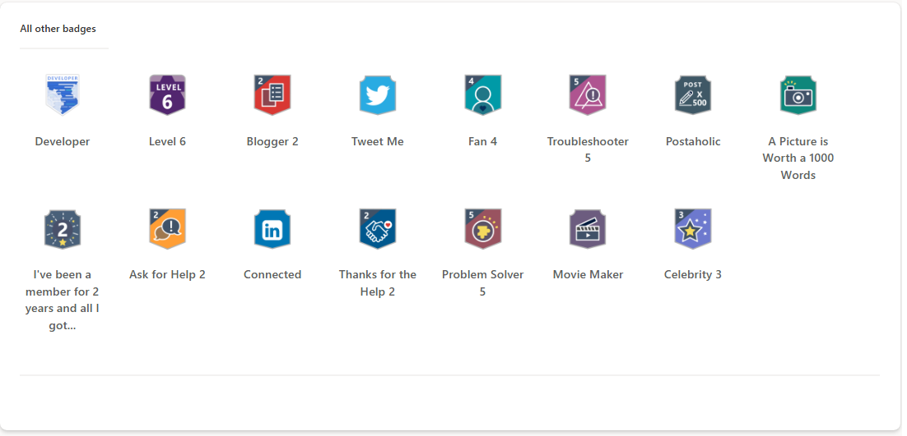

 

## Certifications

<!-- CREDLY-BADGES:START -->
🏅 **Industry Certifications**

📚 **Knowledge & Learning Badges**

<!-- CREDLY-BADGES:END -->

 

https://github.com/AlmasMahfooz/AlmasMahfooz/blob/main/Images/gp2.webp 
https://github.com/AlmasMahfooz/AlmasMahfooz/blob/main/Images/gp3.webp

