<a href="https://github.com/AlmasMahfooz/AlmasMahfooz/blob/08aff8bb57c5882ce3ad783cb57365d6e365f090/Images/certificate-hands-on-introduction-to-kql-for-security-analysis-6aaaeaf7aa5cd0250b092d7f.pdf">

 
Hands-On   
Introduction to    
KQL for Security   
Analysis

</a> 

<!-- CREDLY-BADGES:START -->

<!-- CREDLY-BADGES:END -->

 

 

